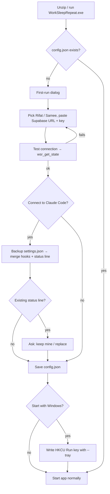

# Work•Sleep•Repeat — App Flow (v2)

> How the app behaves, step by step, from install to daily use. Contracts referenced here live in `techspec.md`.

---

## 1. First install



After setup, the user must **restart any open Claude Code sessions** so they load the new hooks. The dialog says so.

---

## 2. App startup (every time)

1. Parse args (`--me`, `--tray`, `--offline`, `--dev`, `--setup`).
2. Try to bind `127.0.0.1:47821`.
   - Taken → `POST /show` to the running copy → exit. (One copy only.)
3. Load config. Build `AppState`.
4. Start threads: listener, sync (unless `--offline`), tray.
5. Sync thread first call: read own row. Resume `today_seconds` if `today_date` is today (Dhaka).
6. Create GLUT window. If `--tray`, hide it straight away.
7. Main loop: each frame → `snapshot()` → character / lighting / panel draw. Once per second → `activity.tick()`, `alerts.check()`, time counter.

---

## 3. Daily use: Rifat starts working

```
Rifat types a prompt in Claude Code
  → UserPromptSubmit hook → curl POST /hook
  → listener → activity.handle() → session.turn_active = true
  → AppState.me.working = true, since = now → outbox: status
  → Rifat's room: character gets up, walks, sits (existing animation)
  → sync thread (≤ 2 s) → wsr_update_status('rifat', {working:true, since})
Samee's app
  → next poll (≤ 2 s) → sees rifat.working = true
  → Rifat's room on Samee's screen animates to desk
  → tray icon: lit lamp · tooltip "Rifat is working"
```

End-to-end target: under 3 s on both screens (PRD FR1).

## 4. Long autonomous run

```
One prompt → Claude works for 25 min using tools
  UserPromptSubmit → turn_active = true
  PostToolUse (many) → last_event keeps updating
  Stop → turn_active = false
  → still "working" for IDLE_TIMEOUT (10 min) after Stop, in case Rifat reads and replies
```

## 5. Rifat stops

```
Either: no Claude Code event for 10 min (and no turn active)
Or:     all sessions ended (SessionEnd for each)
  → activity.tick() → working = false → outbox: status
  → Rifat's character walks back to bed
Samee's app next poll
  → rifat.working true → false
  → alerts: "Claude is free — Rifat just finished."
     (or "Your turn" if Samee had called dibs)
```

## 6. Crash safety

```
Claude Code window killed mid-turn → no Stop, no SessionEnd
  → turn_active stays true
  → after TURN_STALE_CAP (30 min) with no event, tick() drops the session
  → working = false
```

---

## 7. Usage numbers

```
Claude Code renders status line (after any response)
  → curl POST /statusline with JSON (has rate_limits)
  → listener: parse → UsageReport
     reply immediately with the status line text (design.md §6)
  → changed or 60 s passed? → outbox: usage
  → sync → wsr_report_usage(me, observed_at, 5h %, reset, week %, reset)
     server: ignore if older than last report
             credit the increase to the reporter (same window)
             start a new window's share if reset time changed
Both apps next poll → wsr_get_state → bars, "updated ago", split
Alerts: threshold crossings → toasts (once per threshold per window)
```

When nobody uses Claude Code, nothing updates. The panel shows "updated 2 h ago". When a reset time passes, that bar shows "reset — no new data yet".

---

## 8. Call dibs

```
Samee working. Rifat clicks [Call dibs] (panel or tray)
  → me.wants_next = true, wants_next_at = now → push
Samee's app
  → sees rifat.wants_next false → true
  → toast "Rifat wants it next" + bubble over Rifat's character
Samee stops → Rifat gets "Your turn"
Rifat starts working → Rifat's wants_next auto-clears
(or Rifat cancels, or 2 h passes → auto-clear)
```

Dibs button only shows while the other person is working.

---

## 9. Both working (conflict)

```
Both working for > 30 s
  → panel: "Both of you are on it!" + blinking lamps (existing)
  → toast once per overlap: "You're both on it"
  → status line gets ⚠
```

---

## 10. Network problems

```
Poll fails twice → connected = false
  → panel bottom line "offline — retrying", tray icon grey
  → own detection keeps working locally, outbox keeps latest status/usage
  → backoff 2 → 4 → 8 → 16 → 30 s
Poll succeeds → flush outbox → connected = true → normal 2 s polling
```

Peer PC off → peer heartbeat older than 60 s → "Samee is offline", darker room, grey dot.

## 11. PC sleep / wake

```
Wake → sync loop sees time jump > 30 s
  → immediate reconnect + full re-push of own status
  → activity.tick() drops sessions older than the caps
  → midnight passed while asleep? clock.py resets today_seconds
```

## 12. Midnight (Asia/Dhaka)

```
00:00 → today_seconds = 0, today_date = new date → push
(no history kept — by design)
```

---

## 13. Window and tray

| Action | Result |
|---|---|
| Click tray icon / "Open rooms" | show window, bring to front |
| Window close button (X) | hide window, app keeps running in tray |
| `ESC` | hide window (same as X) |
| Tray → Quit | stop threads, push `working=false`? **No** — push nothing; status stays truthful because hooks stop and peer sees heartbeat go stale → "offline" |
| Start at login (`--tray`) | runs hidden, only tray icon |

## 14. Remove / reinstall Claude Code integration

Tray → Claude Code integration →
- **Remove hooks**: backup → remove only our entries (matching `127.0.0.1:47821`) → restore previous status line if we saved one.
- **Reinstall hooks**: same as setup step G/H.

## 15. Dev mode (`--dev`)

- Keys `1` / `2`: inject fake prompt / fake session end for *me* into the activity engine.
- `D` debug view, `G` grid (unchanged). FPS shown only in debug view.
